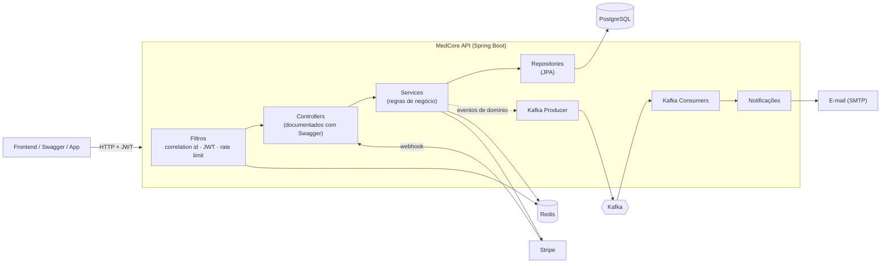
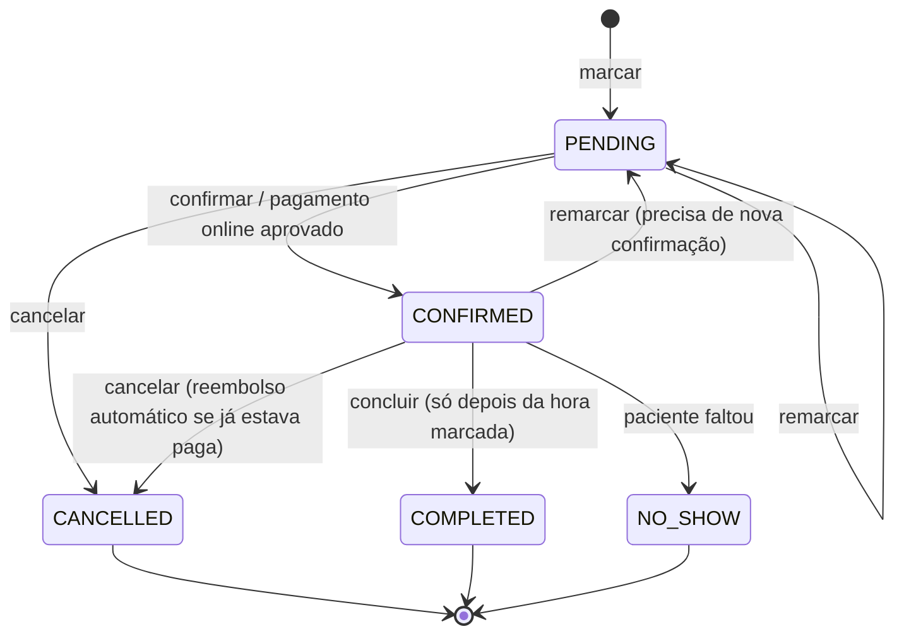
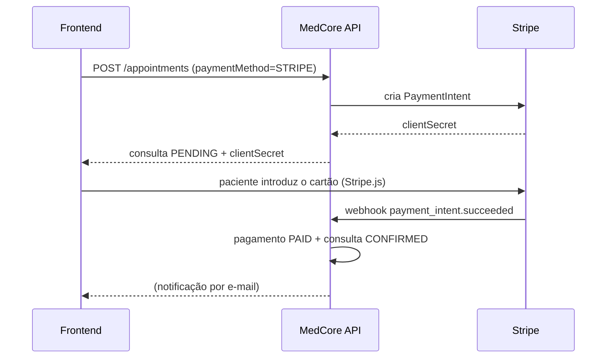

# MedCore Healthcare Platform — API

API backend para gerir **clínicas, médicos, pacientes e consultas médicas**: marcação online sem conflitos de horário, pagamentos com Stripe, notificações automáticas e registo de auditoria.

> **Em poucas palavras:** um paciente cria conta, vê os horários livres de um médico, marca a consulta e paga online (ou na clínica). A clínica confirma, o médico realiza a consulta e todos recebem notificações pelo caminho.

---

## Índice

1. [O que o sistema faz](#1-o-que-o-sistema-faz)
2. [Tecnologias](#2-tecnologias)
3. [Como executar](#3-como-executar)
4. [Primeiros passos: a sua primeira consulta](#4-primeiros-passos-a-sua-primeira-consulta)
5. [Como funciona por dentro](#5-como-funciona-por-dentro)
6. [Endpoints da API](#6-endpoints-da-api)
7. [Estrutura do projecto](#7-estrutura-do-projecto)
8. [Padrões de projecto](#8-padrões-de-projecto)
9. [Configuração](#9-configuração)
10. [Testes](#10-testes)
11. [Resolução de problemas](#11-resolução-de-problemas)
12. [Estado do projecto](#12-estado-do-projecto)
13. [Glossário](#13-glossário)

---

## 1. O que o sistema faz

| Área | Funcionalidades |
|---|---|
| **Contas e acesso** | Registo, login, verificação de e-mail, recuperação de senha, autenticação em dois passos (2FA) e cinco perfis de utilizador |
| **Marcação de consultas** | Horários livres por médico, marcação, remarcação, cancelamento, confirmação, conclusão e lembretes automáticos |
| **Pagamentos** | Online com cartão (Stripe), na recepção da clínica ou por seguro de saúde, com reembolsos e recibos |
| **Notificações** | Cada acontecimento importante (consulta marcada, pagamento recebido…) gera uma notificação e um e-mail |
| **Segurança e auditoria** | Cada utilizador só vê os seus dados, há limite de pedidos por minuto e todas as alterações ficam registadas |

### Perfis de utilizador

| Perfil | O que pode fazer |
|---|---|
| `PATIENT` (paciente) | Criar conta, marcar, remarcar e cancelar **as suas** consultas, pagar |
| `DOCTOR` (médico) | Ver a **sua** agenda, confirmar, concluir e marcar falta |
| `RECEPTIONIST` (recepção) | Gerir as consultas e os pagamentos da **sua** clínica |
| `CLINIC_ADMIN` (administrador da clínica) | O mesmo que a recepção, para a **sua** clínica |
| `SUPER_ADMIN` | Acesso total à plataforma |

---

## 2. Tecnologias

| Tecnologia | Para que serve neste projecto |
|---|---|
| **Java 21 + Spring Boot 4.1** | Linguagem e framework da aplicação |
| **Spring Security + JWT** | Login e controlo de acessos |
| **PostgreSQL 17** | Base de dados principal |
| **Flyway** | Cria e actualiza as tabelas automaticamente ao arrancar |
| **Redis** | Cache, limite de pedidos, tokens de sessão e códigos temporários |
| **Apache Kafka** | Fila de eventos (por exemplo, "consulta marcada") processados em segundo plano |
| **Stripe** | Pagamentos com cartão |
| **SpringDoc / Swagger** | Documentação interactiva da API |
| **Docker** | Corre tudo (base de dados, Kafka…) sem instalar nada manualmente |
| **JUnit, Mockito, Testcontainers** | Testes automáticos, incluindo testes com uma base de dados real |

---

## 3. Como executar

### Pré-requisitos

- [Docker Desktop](https://www.docker.com/products/docker-desktop/) instalado e **a correr**.
- O Java 21 só é necessário se quiser correr a aplicação fora do Docker.

### Opção A: tudo no Docker (recomendado)

```bash
# 1. Arranca a base de dados, Redis, Kafka, servidor de e-mail e a API
docker compose --profile app up -d --build

# 2. (Opcional, mas recomendado) carrega uma clínica e um médico de demonstração
docker compose exec -T postgres psql -U medcore -d medcore < docs/demo-data.sql
```

Na primeira vez, o passo 1 demora alguns minutos porque descarrega as imagens e compila o projecto.

### Opção B: só a infra-estrutura no Docker, a API no seu computador

Útil durante o desenvolvimento, para reiniciar a API rapidamente:

```bash
docker compose up -d        # Postgres, Redis, Kafka e Mailpit
./mvnw spring-boot:run      # a API arranca em http://localhost:8080
```

> ⚠️ Se já tiver um PostgreSQL instalado no computador, ele ocupa a porta 5432 e a API vai ligar-se a ele em vez do container. Nesse caso use a Opção A. Os detalhes estão em [Resolução de problemas](#11-resolução-de-problemas).

### Endereços úteis

| Endereço | O que é |
|---|---|
| http://localhost:8080/swagger-ui.html | **Swagger**: documentação interactiva onde pode testar a API pelo browser |
| http://localhost:8080/v3/api-docs | Especificação OpenAPI em JSON (para importar no Postman, Insomnia…) |
| http://localhost:8025 | **Mailpit**: caixa de correio falsa que apanha todos os e-mails enviados pela aplicação |
| http://localhost:8080/actuator/health | Estado da aplicação (`{"status":"UP"}`) |

### Parar

```bash
docker compose --profile app down        # pára tudo e mantém os dados
docker compose --profile app down -v     # pára tudo e APAGA os dados
```

---

## 4. Primeiros passos: a sua primeira consulta

Este guia usa o **Swagger** (http://localhost:8080/swagger-ui.html). Em cada endpoint, clique em **Try it out**, preencha o corpo e clique em **Execute**.

Antes de começar, carregue os dados de demonstração (passo 2 da Opção A). O script cria:

| O quê | Dados |
|---|---|
| Clínica | MedCore Clínica Central (Lisboa, fuso `Europe/Lisbon`) |
| Médica | Dra. Rita Costa, id `33333333-3333-3333-3333-333333333333`, consultas de 30 min, de segunda a sábado, das 09:00 às 17:00, por 60,00 € |
| Login da médica | `medico@medcore.local` / `Medico12345` |
| Login da recepção | `recepcao@medcore.local` / `Medico12345` |

### Passo 1: criar uma conta de paciente

`POST /api/v1/auth/register`

```json
{
  "email": "ana@exemplo.com",
  "password": "Senha-Forte-123",
  "firstName": "Ana",
  "lastName": "Silva"
}
```

### Passo 2: confirmar o e-mail

1. Abra o **Mailpit** (http://localhost:8025) e abra o e-mail "Confirm your MedCore e-mail".
2. Copie o valor que aparece depois de `token=` no link.
3. Envie-o em `POST /api/v1/auth/email/verify`:

```json
{ "token": "COLE_AQUI_O_TOKEN" }
```

### Passo 3: fazer login

`POST /api/v1/auth/login`

```json
{ "email": "ana@exemplo.com", "password": "Senha-Forte-123" }
```

1. Copie o valor de `tokens.accessToken` da resposta.
2. Clique no botão **Authorize** 🔒 no topo do Swagger, cole o token e confirme.
3. A partir daqui, todos os pedidos seguem autenticados.

> O token de acesso expira em 15 minutos. Para obter um novo sem voltar a fazer login, use `POST /api/v1/auth/refresh` com o `refreshToken`.

### Passo 4: ver os horários livres da médica

`GET /api/v1/doctors/{doctorId}/availability`

- `doctorId` = `33333333-3333-3333-3333-333333333333`
- `from` = uma data futura que não seja domingo (por exemplo, `2026-11-03`)

A resposta lista os horários livres. Copie um valor de `start`, por exemplo `2026-11-03T09:00:00Z`.

> As horas vêm em **UTC** (o `Z` no fim). A clínica está em Lisboa, por isso `09:00Z` corresponde às 09:00 no Inverno e às 10:00 no Verão.

### Passo 5: marcar a consulta

`POST /api/v1/appointments`

```json
{
  "doctorId": "33333333-3333-3333-3333-333333333333",
  "scheduledAt": "2026-11-03T09:00:00Z",
  "reason": "Consulta de rotina",
  "paymentMethod": "CLINIC"
}
```

A consulta fica no estado `PENDING` (pendente). Se tentar marcar o **mesmo horário** outra vez, recebe `409 SLOT_UNAVAILABLE`, porque o sistema nunca permite duas consultas sobrepostas para o mesmo médico.

`paymentMethod` aceita três valores:

| Valor | O que acontece |
|---|---|
| `CLINIC` | Paga na recepção. A recepção confirma o pagamento mais tarde. |
| `INSURANCE` | É criada uma referência de pedido ao seguro. |
| `STRIPE` (valor por omissão) | Pagamento online. É devolvido um `clientSecret` para o frontend concluir o pagamento com o Stripe; precisa de chaves Stripe reais (ver [Configuração](#9-configuração)). |

### Passo 6: confirmar como recepção

1. Faça login com `recepcao@medcore.local`, clique em **Authorize** e cole o novo token.
2. Liste as consultas pendentes: `GET /api/v1/appointments?status=PENDING`.
3. Confirme a consulta: `POST /api/v1/appointments/{id}/confirm`.

A consulta passa a `CONFIRMED`. No Mailpit vai ver os e-mails de notificação enviados à paciente e à médica.

---

## 5. Como funciona por dentro

### Visão geral



### O percurso de um pedido

Quando um pedido chega à API, passa por estas camadas por ordem:

1. **Correlation ID:** cada pedido recebe um identificador único (`X-Correlation-Id`), que aparece em todos os logs e eventos. Isto permite seguir um pedido do início ao fim.
2. **Autenticação JWT:** o token é validado e o utilizador é identificado.
3. **Rate limit:** limita os pedidos por minuto, por utilizador ou por IP (10/min nos endpoints de login, para dificultar ataques de força bruta).
4. **Controller:** valida os dados de entrada e verifica o perfil do utilizador.
5. **Service:** aplica as regras de negócio e verifica se o utilizador tem acesso **àquele** recurso específico. Por exemplo, um paciente não vê consultas de outros pacientes.
6. **Auditoria:** todas as alterações são gravadas na tabela `audit_logs`, com quem fez, o quê e quando.
7. **Erros:** qualquer erro é devolvido num formato padrão ([RFC 9457](https://www.rfc-editor.org/rfc/rfc9457)) com um `code` legível por máquinas:

```json
{
  "status": 409,
  "title": "Conflict",
  "detail": "The selected time slot is no longer available",
  "code": "SLOT_UNAVAILABLE",
  "correlationId": "4f9c2d1e-7a3b-4c5d-8e9f-0a1b2c3d4e5f"
}
```

### O ciclo de vida de uma consulta



Qualquer transição fora deste diagrama (por exemplo, concluir uma consulta cancelada) é rejeitada com `409 INVALID_STATE_TRANSITION`.

### Como é impedida a marcação dupla

Dois pacientes podem tentar marcar o mesmo horário no mesmo instante. O sistema protege-se em três camadas:

1. **Validação:** o horário tem de ser um dos horários livres do médico.
2. **Bloqueio:** enquanto uma marcação está a ser gravada, o registo do médico fica bloqueado, por isso a segunda marcação espera pela primeira.
3. **Regra na base de dados:** uma restrição do PostgreSQL (`EXCLUDE USING gist`) impede fisicamente duas consultas activas sobrepostas para o mesmo médico, mesmo que as duas camadas anteriores falhassem.

### Pagamentos online (Stripe)



O webhook valida a assinatura do Stripe e é **idempotente**: se o Stripe enviar o mesmo evento duas vezes, ele só é processado uma vez.

### Eventos e notificações (Kafka)

Sempre que algo importante acontece, a API publica um evento no Kafka **depois** de a alteração ser gravada com sucesso. Os consumidores processam esses eventos em segundo plano (por exemplo, criam notificações e enviam e-mails), sem atrasar a resposta ao utilizador.

| Evento | Quando |
|---|---|
| `appointment.created` / `confirmed` / `cancelled` / `completed` / `rescheduled` | Mudanças na consulta |
| `appointment.reminder` | Lembrete, 24h antes da consulta |
| `payment.created` / `completed` / `failed` / `refunded` | Mudanças no pagamento |
| `prescription.created` | Nova receita médica |
| `notification.created` | Nova notificação, que dispara o envio do e-mail |

Se o processamento de um evento falhar, é **repetido** 3 vezes com intervalos crescentes. Se continuar a falhar, o evento vai para uma fila de "cartas mortas" (`<tópico>.DLT`), fica registado na auditoria e pode ser analisado mais tarde. Nenhum evento se perde em silêncio.

---

## 6. Endpoints da API

A documentação completa, com exemplos e todos os códigos de resposta, está no **Swagger**. Resumo:

### Autenticação: `/api/v1/auth`

| Método | Caminho | Descrição | Autenticação |
|---|---|---|---|
| POST | `/register` | Criar conta de paciente | — |
| POST | `/login` | Login (devolve tokens ou pede o código 2FA) | — |
| POST | `/login/2fa` | Concluir o login com o código 2FA | — |
| POST | `/refresh` | Renovar os tokens | — |
| POST | `/logout` | Terminar sessão | ✅ |
| POST | `/password/forgot` | Pedir recuperação de senha | — |
| POST | `/password/reset` | Definir nova senha | — |
| POST | `/email/verify` | Confirmar o e-mail | — |
| POST | `/email/resend-verification` | Reenviar o e-mail de confirmação | ✅ |
| PUT | `/2fa` | Activar ou desactivar o 2FA | ✅ |
| GET | `/me` | Dados da conta actual | ✅ |

### Consultas

| Método | Caminho | Descrição | Quem |
|---|---|---|---|
| GET | `/api/v1/doctors/{doctorId}/availability` | Horários livres | Público |
| GET | `/api/v1/doctors/{doctorId}/appointments` | Agenda do médico | Médico, staff |
| POST | `/api/v1/appointments` | Marcar consulta | Paciente, staff |
| GET | `/api/v1/appointments` | Pesquisar consultas (com filtros e paginação) | Todos (só vêem o que lhes pertence) |
| GET | `/api/v1/appointments/{id}` | Detalhe da consulta | Envolvidos |
| POST | `/api/v1/appointments/{id}/reschedule` | Remarcar | Paciente, staff |
| POST | `/api/v1/appointments/{id}/cancel` | Cancelar | Paciente, médico, staff |
| POST | `/api/v1/appointments/{id}/confirm` | Confirmar | Médico, staff |
| POST | `/api/v1/appointments/{id}/complete` | Concluir | Médico, staff |
| POST | `/api/v1/appointments/{id}/no-show` | Registar falta | Médico, staff |

### Pagamentos: `/api/v1/payments`

| Método | Caminho | Descrição | Quem |
|---|---|---|---|
| POST | `/` | Iniciar ou repetir um pagamento | Paciente, staff |
| GET | `/{id}` | Estado do pagamento | Envolvidos |
| POST | `/{id}/confirm` | Confirmar um pagamento na recepção ou por seguro | Staff |
| POST | `/{id}/refund` | Reembolsar | Staff |
| GET | `/{id}/receipt` | Recibo | Envolvidos |
| POST | `/api/v1/webhooks/stripe` | Webhook do Stripe | Stripe (com assinatura) |

---

## 7. Estrutura do projecto

```
medcore-api/
├── src/main/java/com/medcore/api/
│   ├── auth/            Registo, login, 2FA, tokens, recuperação de senha
│   ├── appointment/     Consultas: entidade, estados, disponibilidade, marcação, controller, lembretes
│   │   └── state/       Uma classe por estado da consulta (padrão State)
│   ├── payment/         Pagamentos, controller e webhook do Stripe
│   │   └── strategy/    Uma classe por forma de pagamento (padrão Strategy)
│   ├── user/ clinic/ doctor/ patient/
│   ├── medicalrecord/ prescription/ document/ review/
│   ├── notification/    Notificações dos utilizadores
│   ├── audit/           Registo de auditoria
│   ├── messaging/       Eventos, produtor e consumidores Kafka
│   ├── integration/     Ligações a serviços externos: Stripe, e-mail, SMS, armazenamento de ficheiros
│   ├── security/        JWT, filtro de autenticação, armazenamento de tokens
│   ├── config/          Configuração: segurança, Swagger, Kafka, interceptors
│   └── common/          Código partilhado: entidades base, erros, filtros web
├── src/main/resources/
│   ├── application.yml        Configuração da aplicação
│   ├── logback-spring.xml     Formato dos logs
│   └── db/migration/          Scripts SQL do Flyway (criação das tabelas)
├── src/test/                  Testes unitários e de integração
├── docs/demo-data.sql         Dados de demonstração
├── Dockerfile                 Imagem Docker da API
└── docker-compose.yml         Postgres, Redis, Kafka, Mailpit e a API
```

Cada pasta de domínio (`appointment/`, `payment/`…) segue a mesma organização:

| Ficheiro | Papel |
|---|---|
| `Entidade.java` | Tabela da base de dados |
| `EntidadeRepository.java` | Consultas à base de dados |
| `EntidadeService.java` | Regras de negócio |
| `EntidadeController.java` | Endpoints HTTP |
| `dto/` | Formato dos dados que entram e saem da API |

### Base de dados

As tabelas são criadas pelo Flyway em [`V1__init_schema.sql`](src/main/resources/db/migration/V1__init_schema.sql). Todas usam UUID como chave primária.

| Tabela | Conteúdo |
|---|---|
| `users` | Contas de acesso (e-mail, senha cifrada, perfil) |
| `clinics`, `clinic_opening_hours`, `clinic_staff` | Clínicas, horário de funcionamento e equipa |
| `doctors`, `specialties`, `doctor_specialties`, `schedules` | Médicos, especialidades e horários semanais |
| `patients` | Perfil do paciente (dados pessoais, contacto de emergência, tipo sanguíneo, alergias) |
| `appointments` | Consultas |
| `payments` | Pagamentos |
| `medical_records`, `prescriptions`, `prescription_items` | Prontuários e receitas |
| `documents` | Ficheiros (exames, receitas, recibos) |
| `notifications` | Notificações |
| `reviews` | Avaliações dos médicos |
| `audit_logs` | Registo de auditoria |

Para alterar a base de dados, crie um novo ficheiro `V3__descricao.sql` em `db/migration/`. **Nunca altere migrations que já foram aplicadas.**

---

## 8. Padrões de projecto

| Padrão | Onde | Que problema resolve |
|---|---|---|
| **Repository** | `*Repository` | Isola o acesso à base de dados das regras de negócio |
| **Service** | `*Service` | Concentra as regras de negócio num só lugar |
| **Facade** | `AppointmentBookingFacade` | Marcar uma consulta envolve agenda e pagamento; a facade expõe isso numa única operação simples. Também cancela e reembolsa de uma só vez |
| **Strategy** | `payment/strategy/` | Cada forma de pagamento (`OnlineAppointmentPayment`, `ClinicPayment`, `InsurancePayment`) tem as suas regras. Para acrescentar uma nova basta criar uma classe, sem alterar o resto |
| **Adapter** | `integration/` | O código de negócio fala com interfaces simples (`PaymentGateway`, `EmailSender`, `SmsSender`, `StorageService`). Trocar o Stripe por outro fornecedor, ou o disco local pelo S3, é só escrever um novo adaptador |
| **Observer** | `messaging/` | Os services anunciam "aconteceu X" e não sabem quem reage. Notificações, e-mails e auditoria reagem de forma independente |
| **State** | `appointment/state/` | Cada estado da consulta sabe que transições permite, o que evita regras espalhadas por `if`s |
| **Specification** | `AppointmentSpecifications` | Filtros de pesquisa combináveis (por médico, data, estado…), além do filtro automático "só vê o que é seu" |

---

## 9. Configuração

A configuração está em [`application.yml`](src/main/resources/application.yml) e cada valor pode ser substituído por uma variável de ambiente. Para uso local, copie `.env.example` para `.env` e preencha os valores. Os valores por omissão já servem para correr localmente.

| Variável | Para quê | Valor por omissão |
|---|---|---|
| `DB_URL`, `DB_USERNAME`, `DB_PASSWORD` | Ligação ao PostgreSQL | `localhost:5432/medcore`, `medcore`, `medcore` |
| `REDIS_HOST`, `REDIS_PORT` | Ligação ao Redis | `localhost`, `6379` |
| `KAFKA_BOOTSTRAP_SERVERS` | Ligação ao Kafka | `localhost:9092` |
| `MAIL_HOST`, `MAIL_PORT` | Servidor de e-mail | `localhost`, `1025` (Mailpit) |
| `JWT_SECRET` | Chave para assinar os tokens. **Obrigatória em produção**; gere uma com `openssl rand -base64 48` | chave de desenvolvimento |
| `STRIPE_API_KEY` | Chave secreta do Stripe (`sk_test_...`) | placeholder |
| `STRIPE_WEBHOOK_SECRET` | Segredo do webhook do Stripe (`whsec_...`) | placeholder |
| `FRONTEND_URL` | Usado nos links dos e-mails | `http://localhost:3000` |
| `RATE_LIMIT_RPM` / `RATE_LIMIT_AUTH_RPM` | Pedidos por minuto (geral / login) | `120` / `10` |
| `STORAGE_ROOT` | Pasta onde são guardados os ficheiros | `./storage` |

### Testar pagamentos Stripe localmente

1. Crie uma conta gratuita em [stripe.com](https://stripe.com) e copie a chave de teste `sk_test_...` para `STRIPE_API_KEY`.
2. Instale a [Stripe CLI](https://docs.stripe.com/stripe-cli) e corra:
   ```bash
   stripe listen --forward-to localhost:8080/api/v1/webhooks/stripe
   ```
3. Copie o `whsec_...` que aparece para `STRIPE_WEBHOOK_SECRET` e reinicie a API.

---

## 10. Testes

```bash
./mvnw test
```

| Teste | O que verifica |
|---|---|
| `AppointmentStateTest` | Todas as transições de estado permitidas e proibidas |
| `PaymentStrategyTest` | Cada forma de pagamento (Stripe simulado com Mockito) |
| `AppointmentServiceTest` | Regras de marcação: horário inválido, conflito, permissões, antecedência mínima para cancelar |
| `MedcoreApiApplicationTests` | Fluxo completo com PostgreSQL, Redis e Kafka **reais** (via Testcontainers): registo → e-mail → login → horários → marcação → bloqueio de marcação dupla → pagamento Stripe por webhook |

O teste de integração precisa do Docker a correr. Sem Docker, é ignorado automaticamente.

---

## 11. Resolução de problemas

| Problema | Causa e solução |
|---|---|
| `Cannot connect to the Docker daemon` | O Docker Desktop não está aberto. Abra-o e espere que fique "running". |
| A API arranca mas dá erros de autenticação na base de dados | Tem um PostgreSQL instalado no computador a ocupar a porta 5432 e a API está a ligar-se a ele. Use a Opção A (`docker compose --profile app up -d`), ou pare o Postgres local. |
| `port is already allocated` ao subir o Docker | Outro programa usa a porta (5432, 6379, 9092, 8025 ou 8080). Feche-o ou altere a porta em `docker-compose.yml`. |
| `401 Unauthorized` no Swagger | O token expirou (dura 15 min) ou não clicou em **Authorize**. Faça login de novo. |
| `422 INVALID_SLOT` ao marcar | O `scheduledAt` não corresponde exactamente a um horário livre. Copie o valor tal como vem em `/availability`. |
| `429 Too Many Requests` | Excedeu o limite de pedidos. Espere 1 minuto. |
| Não chegou nenhum e-mail | Os e-mails não saem para a internet; veja-os no Mailpit, em http://localhost:8025. |
| Ver o que a API está a fazer | `docker compose logs -f api` |

---

## 12. Estado do projecto

**Funcionalidades completas:** autenticação (incluindo 2FA), marcação de consultas, pagamentos, notificações, eventos Kafka, auditoria, rate limiting e documentação Swagger.

**Já modelado na base de dados, mas ainda sem endpoints:**
- Gestão de clínicas, médicos e pacientes (por agora use `docs/demo-data.sql`)
- Prontuários médicos e receitas (incluindo geração do documento da receita)
- Documentos e avaliações

**Melhorias técnicas planeadas:**
- Limpar a cache de horários quando o horário de um médico é alterado (hoje a cache expira em 10 minutos)
- *Transactional outbox*, para garantir a entrega de eventos mesmo que a aplicação falhe no momento exacto do envio

---

## 13. Glossário

| Termo | Significado |
|---|---|
| **API REST** | Forma de outros sistemas (site, app móvel) comunicarem com o backend através de pedidos HTTP |
| **JWT** | "Bilhete" digital assinado que prova quem é o utilizador; é enviado em cada pedido |
| **Refresh token** | Token de longa duração usado para obter um novo JWT sem voltar a fazer login |
| **2FA** | Autenticação em dois passos: além da senha, é preciso um código enviado por e-mail |
| **Swagger / OpenAPI** | Documentação da API gerada automaticamente, onde também se pode testá-la |
| **Kafka** | Sistema de mensagens: a API publica eventos e outros componentes processam-nos em segundo plano |
| **DLT (Dead Letter Topic)** | Fila para onde vão as mensagens que falharam várias vezes, para análise |
| **Redis** | Base de dados em memória, muito rápida, usada para dados temporários |
| **Flyway** | Ferramenta que aplica os scripts SQL da base de dados por ordem, automaticamente |
| **Webhook** | Chamada que um serviço externo (o Stripe) faz à nossa API para avisar que algo aconteceu |
| **Idempotente** | Pode ser executado várias vezes com o mesmo resultado que uma só vez |
| **Rate limiting** | Limite de pedidos por minuto, que protege contra abusos |
| **Correlation ID** | Identificador que acompanha um pedido por todo o sistema, para facilitar a investigação de problemas |
| **UTC** | Fuso horário de referência mundial; todas as datas da API são devolvidas em UTC |
